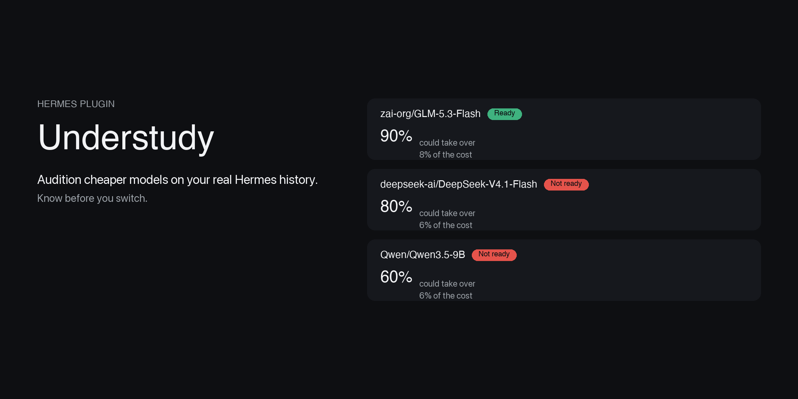
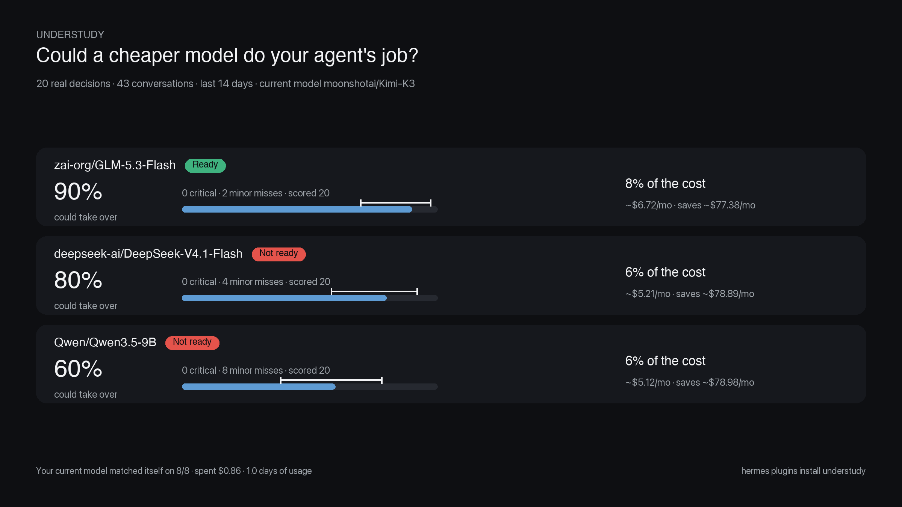

# Understudy



[](https://github.com/stffinfcti/understudy/releases/tag/v1.0.0)

Audition cheaper models on your real Hermes history before you switch.
Understudy replays a sample of your agent's actual past decisions — assistant
replies and tool calls stored in the Hermes session database — on one or more
candidate models, has a judge model compare each candidate step to what your
agent actually did, and reports how often each candidate could have taken
over, its critical misses, and what the switch would cost you per month.

In a real run on a fresh Hermes profile (20 decisions, ~7 minutes, $0.86):
GLM-5.3-Flash matched the current model on **90% of decisions at 8% of the
cost — Ready**, while DeepSeek-V4.1-Flash (80%) and Qwen3.5-9B (60%) both
came back **Not ready**. The current model matched itself 8/8 on the
re-asked baseline subset.

## How it works

1. **Corpus** — reads the local session DB read-only: real decisions from your
   recent conversations (subagent sessions and the current session excluded,
   sources you configured skipped).
2. **Stratified sample** — a deterministic, category-floored sample spread
   across sessions and decision kinds.
3. **Blind replay** — each candidate sees the transcript exactly as your agent
   saw it (truncated, secrets redacted, persona excerpt included) and must
   return the single next step as JSON: a reply or tool calls.
4. **Judge** — the current model (or your `judge_model`) compares production
   vs candidate on substance, blind to which is which; exact matches skip the
   judge entirely.
5. **Baseline noise floor** — your own model re-answers a subset, so a 90%
   takeover rate means "as good as the model was with itself", not perfection.
6. **Wilson CI + verdict** — scored takeover with a 95% interval, critical and
   minor miss rates, per-category breakdown, and a Ready / Partial /
   Not ready / Not enough data verdict.
7. **Pricing** — projected monthly cost from the last 30 days of real token
   usage (scaled by the actual span covered), priced from `settings.prices`,
   local endpoints (free), or Hermes's models.dev cache — never guessed.

## What you get



A chat scorecard like the one above, a self-contained HTML report with a
decision browser (excerpt, your agent's step vs the candidate's, the judge's
reasoning, cost and latency), and a Desktop page for browsing runs.

## Install

```sh
hermes plugins install understudy                                    # from the catalog
hermes plugins install https://github.com/stffinfcti/understudy      # from git
```

On enable, Hermes asks consent for the two capabilities the plugin needs:
`llm.model_override` (run candidates) and `llm.provider_override`
(`provider:model` candidates). The Desktop page is opt-in — enable it under
Capabilities → Plugins.

## Using it

- **Desktop** — sidebar "Understudy": runs list, scorecards, decision browser,
  new-audition dialog.
- **Chat** — ask your agent to audition a model; it calls `understudy_audition`
  (dry-run first, then the run) and posts the scorecard.
- **Slash** — `/understudy openrouter:vendor/model --sample 20 --days 30`;
  `/understudy last`, `/understudy runs`.
- **CLI** — `hermes understudy audition <models…>`, `estimate`, `list`,
  `show [RUN_ID]`.

## Permissions

Model/provider overrides are fail-closed. Grant `llm.model_override` (and
`llm.provider_override` for `provider:model` candidates) on the consent screen,
or set `plugins.entries.understudy.llm.allow_model_override: true` in
config.yaml. Judge calls use your current model unless `judge_model` is set.

## Settings (`plugins.entries.understudy.settings`)

| key | default | meaning |
|---|---|---|
| sample | 20 | past decisions replayed per candidate |
| days | 14 | history window |
| budget_usd | 1.5 | hard spend cap per audition |
| concurrency | 6 | parallel model calls |
| baseline_sample | 8 | decisions your model re-answers |
| judge_model | "" | provider:model for the judge |
| include_persona | true | send a system-prompt excerpt |
| exclude_sources | [] | session sources to skip |
| prices | {} | `"provider:model"`/`"model"` → `{input, output, cache_read?}` USD per 1M tokens |

## Privacy and disclosure

- Reads your local session history **read-only**.
- Sends **redacted excerpts** of past conversations to the candidate models you
  pick and to the judge model, through `ctx.llm` on your existing Hermes
  credentials, capped by `budget_usd`. A candidate on a different provider than
  your usual one receives those excerpts too: only audition providers you trust
  with your chat history.
- Reads Hermes's local `models_dev_cache.json` for list prices.
- Writes run records and reports under `plugin-data/understudy/` (newest 20
  kept).
- Requests `llm.model_override` + `llm.provider_override` capabilities at
  install consent; runs a background worker thread only during an audition.
  No telemetry, no other network calls.

## Limitations

A single-step replay is a proxy for a full agent run: it measures whether the
candidate takes a *sound next step*, not whether it finishes the whole task.
The judge is itself a model and adds noise; small samples give wide CIs —
treat "Not enough data" seriously and widen `sample`/`days`.
